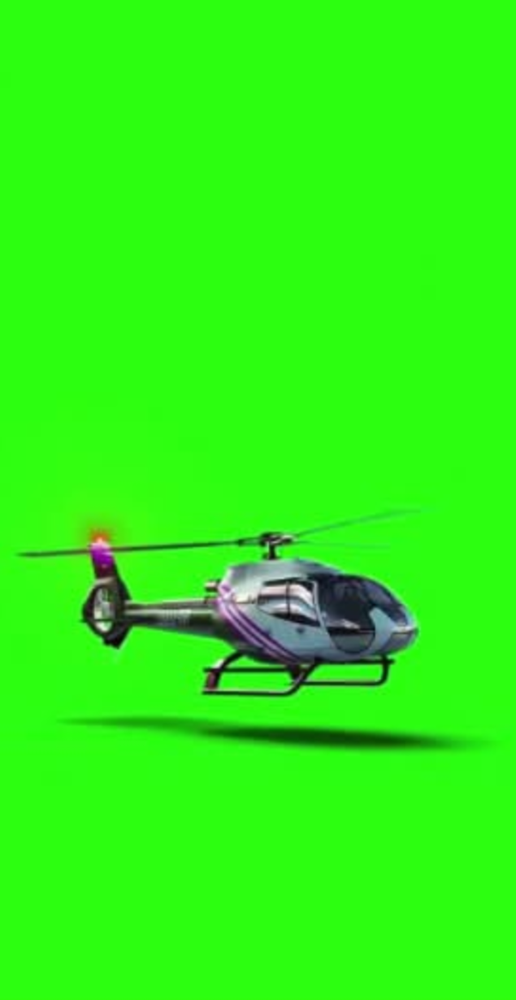
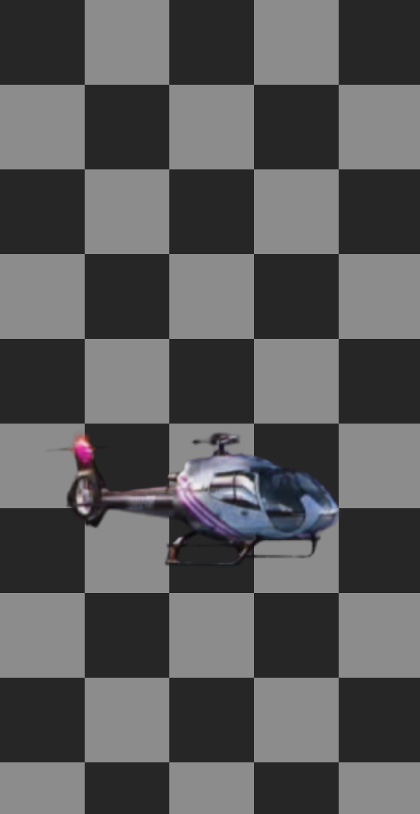
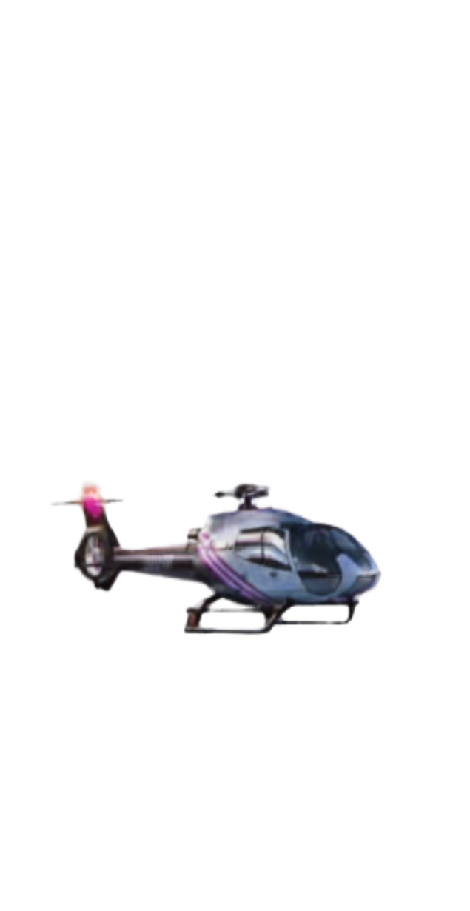
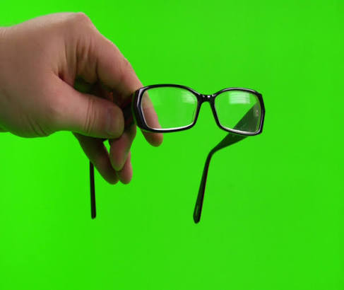
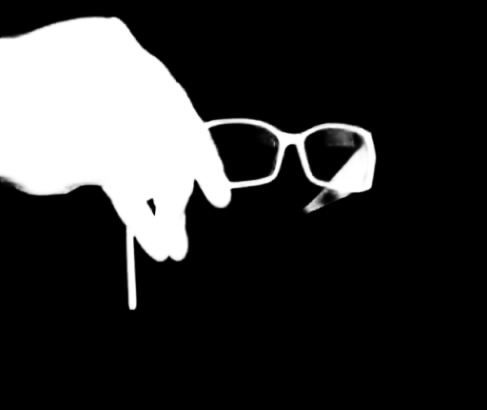
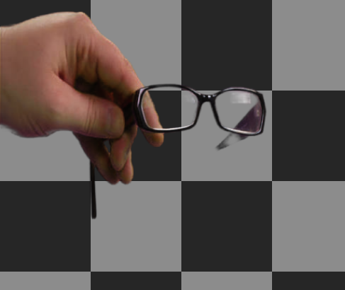
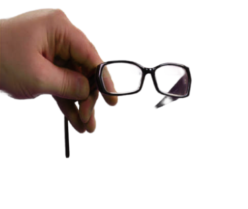

# CorridorKey Studio

A single-file, in-browser front end for [CorridorKey](https://huggingface.co/nikopueringer/CorridorKey_v1.0), the green-screen keying model from Corridor Digital. Load a photo or video, load the model, press Process. Everything runs locally in your browser; nothing is uploaded.

## Examples

Each row is the same frame: source, alpha matte, result over a checkerboard, and result over white.

**Helicopter**

| Source | Alpha | Checkerboard | White |
|:--:|:--:|:--:|:--:|
|  |  |  |  |

**Glasses**

| Source | Alpha | Checkerboard | White |
|:--:|:--:|:--:|:--:|
|  |  |  |  |

Note the glasses: the lower temple arm is missing from the result. The alpha hint (the rough mask the model starts from) didn't include it, and the model works from the hint. A better hint fixes this; see [The alpha hint](#the-alpha-hint).

## Quick start

1. Open `corridorkey-studio-yellow.html` in Chrome or Edge. WebGPU needs HTTPS or `localhost`; opening the file directly may work depending on your browser.
2. Click **Import media** (or drop a file on the stage). PNG, JPEG, WebP, MP4 and WebM are supported.
3. Under **1 · Model & performance**, click **Load .safetensors** and pick `CorridorKey_v1.0.safetensors`, or **Load .onnx** if you have an exported model.
4. Pick a preset (Balanced, Fine detail, Fast preview) and press **Process image / current frame**.
5. Check the result with the view buttons along the top, then export.

## Getting the model

The easiest route is to download `CorridorKey_v1.0.safetensors` (about 400 MB) from [huggingface.co/nikopueringer/CorridorKey_v1.0](https://huggingface.co/nikopueringer/CorridorKey_v1.0) and load it with **Load .safetensors**. The page builds the network in your browser from the weights.

That path is experimental. It needs roughly 1–2 GB of free RAM and works best on desktop Chrome or Edge.

The alternative is to export an ONNX file once with the original repo. The page has a **Download export_onnx.py** button under "Where do I get the model?":

```
pip install torch timm safetensors onnx onnxruntime
python export_onnx.py --repo /path/to/CorridorKey-main \
  --weights CorridorKey_v1.0.safetensors \
  --img-size 1024 --out CorridorKey.onnx --verify
```

You can also host the ONNX file yourself and open the page with `?model=<URL>`. Cross-origin URLs must send CORS headers.

## The alpha hint

CorridorKey needs a coarse alpha hint as input. The page can generate one from the screen colour, or you can upload your own (from GVM, VideoMaMa, BiRefNet, or painted by hand).

- **Generate** uses the green/blue dominance of each pixel. Tune Threshold, Softness, Erode and Feather. It is a helper, not part of the original model, and is only a rough guide.
- **Upload** takes any image and resamples it to the footage size. Use this for the cleanest key, or when thin or semi-transparent parts (like the glasses arm above) get lost.

Use the **Hint** view to see what the model is being given.

## Views

| View | Shows |
|---|---|
| Original | The source frame |
| Result | Foreground composited over your chosen background, in linear light |
| Alpha | The matte |
| Foreground | Despilled foreground colour, no matte applied |
| Hint | The coarse mask fed to the model |
| Spill removed | How much colour the despill step changed (a diagnostic) |
| Before/After | Source and result with a draggable split |

## Controls

- **Size**: working resolution (512, 768, 1024, 2048). Lower is faster but softer. 2048 is the native size and very heavy in a browser.
- **Backend**: WebGPU, or WASM on the CPU (very slow).
- **Refiner strength**: scales the refiner's correction. Changing it needs a re-run.
- **Despill strength**, **auto-despeckle** and **despeckle size**: update live without re-running the model.
- **Output resampling**: bilinear (the original GPU path) or Lanczos4 (the original CPU path).
- **Screen**: Green or Blue, matching your footage.
- **Background**: checkerboard, solid colour, or an image with fit, scale and offset.

## Exporting

- **PNG (straight RGBA)**: despilled foreground with a real alpha channel. Colour is not premultiplied, so low-alpha edge pixels keep their colour.
- **Comp PNG**: the result flattened over the selected background.
- **Alpha PNG**: the matte as greyscale.
- **Video → MP4**: processes every frame and encodes H.264 with your chosen background. It needs a browser with WebCodecs H.264 encoding and an internet connection to load the MP4 encoder. Original audio is not included. Tick "Write frames to a folder" to avoid memory growth on long clips (Chromium only).

## Limitations

- Large models in a browser are heavy. Expect long processing times at 1024 and above.
- Video is processed frame by frame; there is no temporal smoothing beyond what the model does itself.
- The generated hint is a convenience. Results depend heavily on hint quality.

## Credits and license

CorridorKey is by Corridor Digital, released under CC BY-NC-SA 4.0 with additional terms. Redistribution of converted models is restricted by those terms. Check them before sharing an exported ONNX file or using results commercially.
